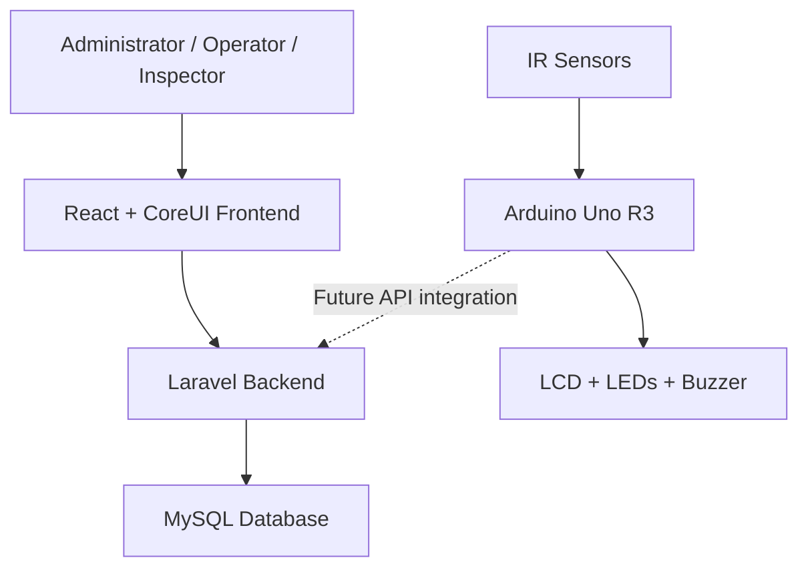

# SPMods
### Smart Passenger Counter & Load Balancer

**Safer Rides. Fairer Loads. Smarter Transport.**

SPMods is a web-based passenger monitoring and overloading detection system designed for jeepneys and UV Express vehicles in the Philippines. It combines an Arduino-based hardware prototype with a Laravel and React web application to monitor passenger counts, manage transport records, and help identify potential overloading violations.

> **Project Status:** In Development

---

## Table of Contents

- [Overview](#overview)
- [Objectives](#objectives)
- [Key Features](#key-features)
- [Technology Stack](#technology-stack)
- [System Architecture](#system-architecture)
- [Hardware Components](#hardware-components)
- [Database Overview](#database-overview)
- [API Endpoints](#api-endpoints)
- [Installation](#installation)
- [Running the Project](#running-the-project)
- [Testing and Quality Assurance](#testing-and-quality-assurance)
- [Security](#security)
- [Future Improvements](#future-improvements)
- [Disclaimer](#disclaimer)

---

## Overview

Overloading can compromise passenger safety and make transport regulation more difficult. SPMods aims to provide a prototype system for monitoring passenger occupancy and maintaining organized transport records.

The system combines:

- An Arduino Uno R3 prototype for passenger counting.
- A Laravel backend for business logic and data management.
- A React-based administrative interface.
- A MySQL database for storing system records.
- API endpoints for communication between application components.

SPMods is intended as a learning and prototyping project demonstrating the integration of web development, database management, hardware, API development, and software quality assurance.

## Objectives

1. Monitor passenger entry and exit using infrared sensors.
2. Track passenger counts against a vehicle's configured capacity.
3. Provide visual and audible alerts when the capacity threshold is reached or exceeded.
4. Maintain records for drivers, vehicles, routes, trips, and passenger counts.
5. Record potential overloading incidents for review.
6. Provide role-based access for authorized system users.
7. Apply software testing practices to improve system reliability and security.

## Key Features

- **Passenger Counting:** Detect entry and exit events through IR sensors.
- **Capacity Monitoring:** Compare passenger counts with configured vehicle capacity.
- **Overloading Alerts:** Use LEDs and a buzzer in the hardware prototype.
- **Vehicle Management:** Store vehicle details, plate numbers, and capacity.
- **Driver Management:** Maintain driver profiles and associated records.
- **Route Management:** Organize transport routes and destinations.
- **Trip Monitoring:** Store trip and passenger-log records.
- **Violation Tracking:** Maintain records of potential capacity violations.
- **Notifications:** Support system notifications for relevant events.
- **Role-Based Access:** Differentiate access for administrators, operators, and inspectors.
- **API Development:** Provide backend endpoints for application integration.
- **Quality Assurance:** Document test cases, execution results, evidence, and defects.

---

## Technology Stack

| Technology | Purpose |
|---|---|
| PHP | Backend programming language |
| Laravel 13 | Backend framework |
| React | User interface |
| TypeScript / TSX | Frontend development |
| Inertia.js | Connects Laravel and React |
| CoreUI React | Administrative interface components |
| MySQL | Relational database |
| Laravel Sanctum | API authentication |
| Spatie Laravel Permission | Roles and permissions |
| Arduino Uno R3 | Hardware controller |
| IR Sensors | Passenger entry and exit detection |
| LCD 16×2 I2C | Passenger-count display |
| LEDs and Buzzer | Capacity alerts |
| Docker Compose | Local development environment |
| Pest / PHPStan / Laravel Pint | Testing, static analysis, and code formatting |

---

## System Architecture



The web application manages transport records and backend operations. The Arduino prototype handles sensor-based passenger counting and local alerts.

**Note:** Direct Arduino-to-Laravel communication is a planned integration unless explicitly implemented and verified in the current version.

---

## Hardware Components

| Component | Function |
|---|---|
| Arduino Uno R3 | Processes sensor inputs |
| 2 IR Sensors | Detect passenger entry and exit |
| 16×2 LCD with I2C | Displays passenger count |
| LEDs | Indicate capacity status |
| Buzzer | Provides an audible alert |
| Breadboard and Jumper Wires | Prototype circuit connections |
| Power Supply | Supplies power to the circuit |

### Hardware Logic

1. An IR sensor detects a passenger entering or exiting.
2. The Arduino updates the passenger count.
3. The current count is compared with the configured capacity.
4. The LCD displays the updated count.
5. LEDs and the buzzer provide alerts when the capacity threshold is reached or exceeded.

Sensor placement, simultaneous detections, and counting accuracy must be tested on the physical prototype.

---

## Database Overview

The MySQL database is named `smart_passenger_monitoring`.

| Table | Purpose |
|---|---|
| `users` | User accounts and role-related access |
| `drivers` | Driver profiles and license information |
| `vehicles` | Vehicle details, capacity, and assignments |
| `transport_routes` | Route names, origins, and destinations |
| `trips` | Trip records and associated transport data |
| `passenger_logs` | Passenger counts and occupancy information |
| `violations` | Records of potential overloading incidents |
| `notifications` | System notification records |
| `personal_access_tokens` | Sanctum API token records |

Relationships connect drivers, vehicles, routes, trips, passenger logs, violations, and notifications.

The actual migrations and model relationships are the source of truth for the current database structure.

---

## API Endpoints

### Driver API

The driver API uses Laravel resource routes.

| Method | Endpoint | Purpose |
|---|---|---|
| GET | `/api/drivers` | List drivers |
| POST | `/api/drivers` | Create a driver |
| GET | `/api/drivers/{driver}` | Retrieve a driver |
| PUT / PATCH | `/api/drivers/{driver}` | Update a driver |
| DELETE | `/api/drivers/{driver}` | Delete a driver |

### Authentication and Authorization

The driver API routes are configured to use:

- `auth:sanctum` — requires an authenticated request.
- `role:admin` — restricts access to users with the administrator role.

An unauthenticated JSON request to `GET /api/drivers` returned:

```http
HTTP/1.1 401 Unauthorized
Content-Type: application/json
```

```json
{
  "message": "Unauthenticated."
}
```

This verifies the observed unauthenticated behavior for the driver listing endpoint. The remaining endpoints, authenticated role checks, and CRUD operations require their own tests.

---

## Installation

### Prerequisites

Install the tools required by your development environment:

- Git
- Docker Desktop with Docker Compose
- A compatible code editor, such as Visual Studio Code

For a direct local installation, you will also need compatible PHP, Composer, Node.js, npm, and MySQL installations.

### 1. Clone the Repository

Replace the example URL with your actual GitHub repository URL.

```bash
git clone https://github.com/YOUR-USERNAME/spmods.git
cd spmods
```

### 2. Install Dependencies

For the Docker-based development environment, use the project's documented container setup.

For a direct local installation:

```bash
composer install
npm install
```

### 3. Configure the Environment

Create your environment file if it does not exist:

```bash
cp .env.example .env
```

Configure the database connection and other required environment variables.

Do not commit `.env` or other files containing credentials.

### 4. Generate the Application Key

```bash
php artisan key:generate
```

### 5. Run Database Migrations

Review the configured database connection before running migrations.

```bash
php artisan migrate
```

Run seeders only if they are configured for your environment and you understand the data they will create.

### 6. Start the Development Server

For a direct local installation:

```bash
php artisan serve
```

In another terminal:

```bash
npm run dev
```

For the Docker environment, use the project's Docker Compose services and documented startup commands.

---

## Running the Project

For the Docker-based environment, run Artisan commands through the Laravel container:

```bash
docker compose exec laravel.test php artisan route:list
```

To inspect the driver API routes and middleware:

```bash
docker compose exec laravel.test php artisan route:list --path=api/drivers -v
```

The actual local URL and port depend on your Docker Compose configuration.

---

## Testing and Quality Assurance

SPMods includes a documented QA workflow using a dedicated test workbook.

The workflow covers:

1. Reviewing test plans, scenarios, and expected results.
2. Preparing preconditions and synthetic test data.
3. Executing test cases.
4. Recording actual results and statuses.
5. Saving terminal output, screenshots, and other evidence.
6. Logging defects and retesting fixes.
7. Performing regression testing.

### QA Tools

- **Pest:** Automated application tests.
- **PHPStan:** Static analysis.
- **Laravel Pint:** Code formatting.
- **Postman / cURL:** API testing.
- **QA Workbook:** Test plans, scenarios, cases, execution logs, defect records, and traceability.

### Example Commands

```bash
php artisan test
```

```bash
./vendor/bin/phpstan analyse --memory-limit=1G
```

```bash
./vendor/bin/pint --test
```

For Docker-based execution, run the corresponding commands inside the Laravel container.

### API Security Testing

The driver API should be tested for:

- Unauthenticated access.
- Access by authenticated non-admin users.
- Access by authorized administrators.
- Request validation and duplicate records.
- Successful and unsuccessful CRUD operations.
- Appropriate handling of nonexistent records.
- Data integrity and related-record constraints.

A test must only be marked **Pass** when the observed result satisfies its documented expected result.

---

## Security

SPMods uses Laravel's authentication and authorization capabilities.

Security considerations include:

- Sanctum authentication for protected API routes.
- Role-based access checks through Spatie Laravel Permission.
- Server-side request validation.
- Protection of environment files and credentials.
- Restricted access to driver and transport records.
- Safe handling of API tokens and session credentials.
- Separate, limited authentication for future hardware integration.

Installing authentication packages alone does not secure every endpoint. Each route must be configured and tested according to its intended access rules.

Never embed a long-lived administrator token in Arduino firmware.

---

## Future Improvements

- Complete Arduino-to-Laravel API integration.
- Add dedicated device authentication.
- Improve sensor accuracy and prevent duplicate counts.
- Add live occupancy monitoring to the web dashboard.
- Expand automated API and feature tests.
- Add comprehensive role and permission tests.
- Improve reporting and visualization of passenger and violation records.
- Add deployment documentation and production security checks.

---

## Disclaimer

SPMods is an academic and prototype project intended to demonstrate passenger counting, capacity monitoring, web application development, and software testing.

Its records and alerts should not be treated as official enforcement decisions without appropriate validation, operational testing, and authorization by the relevant transport authorities.

---

## Project Status

**Status:** In Development

SPMods is being developed as a practical learning project combining backend development, frontend integration, hardware prototyping, database design, API security, and quality assurance.

**Safer Rides. Fairer Loads. Smarter Transport.**
